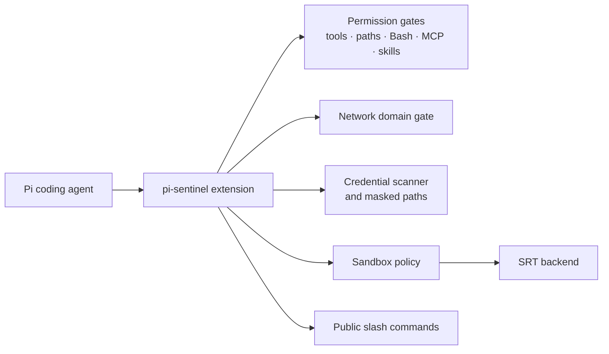

# pi-sentinel

Pi extension for permission enforcement, network domain gating, sandboxed Bash, and credential protection.

## Quick start

Install a reviewed Git ref:

```bash
pi install git:git@github.com:DxTa/pi-sentinel@<reviewed-tag-or-commit>
```

The first release is Git-only. Pi installs dependencies from `package.json`; no build step is required. The npm package name is reserved but not yet published.

Bundled defaults are conservative:

- sandbox enabled with SRT and the network-enabled `online-dev` profile;
- reads allowed, writes and edits denied;
- Bash asks by default, except for `git status` and `git diff`;
- after approval, bundled profiles permit Docker CLI access through its validated Unix socket by default; set `allowDocker: false` to disable it;
- generated `pi-clipboard-<uuid>.*` files referenced during a session are removed at session shutdown;
- On macOS and Linux, sandboxed commands allow all Unix sockets by default so local services can work; this exposes Docker, SSH agents, databases, and other host Unix services to sandboxed code.
- Docker socket access is host-admin equivalent: Docker can mount or read host paths despite the SRT filesystem boundary; direct Docker and Compose commands remain approval-gated.
- Sandboxed commands receive read-only visibility for `~/.config`, `~/.gitconfig`, and `~/.gitignore`; protected credential files under `~/.config` remain masked.
- SRT-wrapped Docker commands automatically receive read-only access to `~/.docker/config.json`; host-bypassed Bash has normal host filesystem access.
- SRT-wrapped commands require outbound-domain approval unless explicitly allowed; host-bypassed Bash uses host network after preflight checks.

## Features

- **Permission policy** for tools, paths, Bash commands, MCP, skills, and external directories with `allow`, `deny`, and `ask` states.
- **Network domain gate** that extracts domains from Bash and applies allow/deny/ask rules.
- **Sandboxed Bash** through SRT, with fail-closed behavior when the runtime is unavailable.
- **Credential protection** for sensitive environment variables and files; masked files show names while content is replaced or denied.
- **Dynamic approvals and audit logs** for path/network grants, permission decisions, and optional debug diagnostics.
- **Default-on `yolo-auto`** for model-backed approval of eligible workspace-local reads and listings; deterministic permission, path, credential, network, sandbox, and destructive-action gates still run first.

### `yolo-auto` worker contract

`yolo-auto` is enabled by default. Patronus native L1 runs first, then L2 is the automatic-approval candidate; L3 is available as advisory escalation and never authorizes escalated requests, so escalated requests still prompt. Missing, stale, incompatible, timed-out, or degraded worker results fail closed to the normal permission prompt.

The MIT package does not bundle Patronus Ark or model assets. The external worker must provide Patronus native L1, L2 classifiers, and advisory L3. A separately installed and licensed worker must listen on a user-owned Unix socket and implement the versioned length-delimited JSON handshake/evaluation protocol in `src/yolo-auto-client.ts`. Set `PI_SENTINEL_YOLO_AUTO_SOCKET` to its socket path; otherwise pi-sentinel uses `~/.pi/agent/runtime/pi-sentinel/yolo-auto.sock`. Missing model assets are downloaded and warmed at worker startup, before the socket accepts permission requests; no model downloads occur during permission decisions. `/sentinel show` reports worker state and fallback reason.

When `yoloAutoMode` is enabled, pi-sentinel starts the repository adapter automatically with `python3` unless the configured socket path already exists. Set `PI_SENTINEL_PYTHON` and `PI_SENTINEL_PATRONUS_SITE_PACKAGES` when Patronus Ark is installed outside the active Python environment. Eligible yolo-auto decisions wait for startup readiness; failed startup falls back to the normal prompt.

Worker phases:

```text
l1: Patronus native injection_l1; safe/unsafe/unknown result
l2: tool class/action/tag classifiers; explicit escalation flag
l3: multi-head advisory recommendation after L2 escalation
```

A safe L1 result is required before L2. L1 or L2 failure, uncertainty, degradation, malformed output, or timeout falls back to the normal permission prompt. L3 recommendations never grant authorization.

The repository includes an external-worker adapter. Install Patronus Ark separately, then run; missing assets download and cache atomically during startup:

```sh
python3 bin/patronus-yolo-auto-worker.py \
  --site-packages /path/to/patronus/site-packages \
  --model-dir /path/to/patronus/models
```

Use `PI_SENTINEL_YOLO_AUTO_SOCKET` when the worker socket is not the default. The adapter sets `download_files=true` by default; `--no-download-files` is available for controlled offline runs, but missing assets then stop worker startup instead of downloading during permission decisions.

## How it works



The current entry point uses SRT as its only sandbox backend.

When SRT is enabled, pi-sentinel makes its installed package root and the resolved `@anthropic-ai/sandbox-runtime` root visible read-only inside the sandbox. This allows shipped helpers and the architecture-specific `apply-seccomp` helper to run without exposing writes, disabling network controls, or bypassing credential masking. There is no blanket allowlist for project scripts, tests, npm lifecycle scripts, arbitrary `node_modules`, or user-configured binaries.

## Commands

| Command | Purpose |
| --- | --- |
| `/sentinel [show\|path\|reset\|help]` | Inspect or reset pi-sentinel configuration. |
| `/domain-gate` | Review network-domain policy and approvals. |
| `/sandbox-status` | Check SRT sandbox and dependencies. |
| `/sandbox-grant path <path> [--ro\|--rw] [--ttl <duration>]` | Grant temporary or persistent filesystem access. |
| `/sandbox-grant network --domain <domain> [--ttl <duration>]` | Grant a network domain. |
| `/sandbox-revoke <grant-id>` | Revoke a sandbox grant. |

`yoloMode` auto-approves eligible `ask` checks, including external reads and local writes, but still prompts for first-time external writes and protected bash patterns. Keep it disabled unless unattended execution is intentional.

## Configuration


Bundled defaults live in [`config.json`](config.json). Configuration precedence, lowest to highest:

1. bundled defaults;
2. global `~/.pi/agent/permissions.json`;
3. trusted project `<project>/.pi/permissions.json`;
4. per-agent frontmatter;
5. security profile overlay.

Legacy global/project paths remain supported for compatibility. Use project overrides only in trusted repositories. The last matching wildcard rule wins; `permission.path` is a cross-cutting path gate.

See [`schemas/permissions.schema.json`](schemas/permissions.schema.json) for the complete schema.


### Command access and direct file permissions

Bundled defaults keep SRT enabled for sandbox configuration but set `sandbox.bypassCommands` to `["*"]`. This keeps every Bash command available to the coding session, including host-installed toolchains, virtual-environment creation, `uv`, and global package managers.

Bash permission and preflight network checks run before host execution. Host bypass skips SRT filesystem masking and runtime network isolation, so Bash can read/write host paths and use host network after passing Bash permission. Recognized mutating commands are still hard-blocked when targets leave the working directory, `/tmp`, or `/private/tmp`. Direct `read`, `write`, `edit`, `delete`, path, and external-directory operations remain permission-gated. Set `bypassCommands` to `[]` in a trusted override to restore SRT wrapping for matching commands; built-in Git transport exceptions remain host-bypassed.

Use narrow patterns instead of `"*"` when only selected host setup commands should bypass SRT:

```json
{
  "sandbox": {
    "bypassCommands": [
      "uv venv *",
      "python -m venv *",
      "npm install -g *",
      "cargo install *",
      "go install *"
    ]
  }
}
```

## Host requirements

- Node.js `>=23.6.0`.
- Linux SRT: `rg`, `bwrap`, and `socat`, plus a working user-namespace/bubblewrap setup.
- macOS: SRT runtime support and Command Line Tools when the Git execution shim is needed.
- Windows: permission and network checks work; SRT is unavailable, so Bash is blocked by default unless sandboxing is explicitly disabled.


## Foundation libraries

| Library | Role |
| --- | --- |
| [`@earendil-works/pi-coding-agent`](https://github.com/aliou/pi-coding-agent) | Pi extension API and Bash/tool integration. |
| [`@anthropic-ai/sandbox-runtime`](https://github.com/anthropic-experimental/sandbox-runtime) | SRT filesystem, network, and Linux sandbox runtime. |
| [`tree-sitter-bash`](https://github.com/tree-sitter/tree-sitter-bash) + [`web-tree-sitter`](https://github.com/tree-sitter/web-tree-sitter) | Bash command parsing and path extraction. |
| TypeScript + Vitest | Type checking and tests. |

## Development

```bash
npm ci
npm test
npm run check
```

Tests live beside implementation under `src/`. Package-local tests must not require this repository or a parent checkout.

## Service API

Other Pi extensions can query the process-local permission service:

```typescript
import { getPermissionsService } from "@dxta/pi-sentinel";

const service = getPermissionsService();
const result = service?.checkPermission("bash", "git status");
```

Call `getPermissionsService()` per use so `/reload` and extension load order do not leave a stale reference.

## Security release gate

This repository carries a historical hardening patch for `@anthropic-ai/sandbox-runtime@0.0.59` under [`patches/`](patches/). Git installs use npm and do not apply pnpm patches automatically. Do not publish or tag a security release until an upstream fixed release replaces the patched dependency or the install process applies the hardening explicitly.

## License

MIT. Original upstream attribution is retained in [`LICENSE`](LICENSE); security details are documented in [`SECURITY.md`](SECURITY.md).
